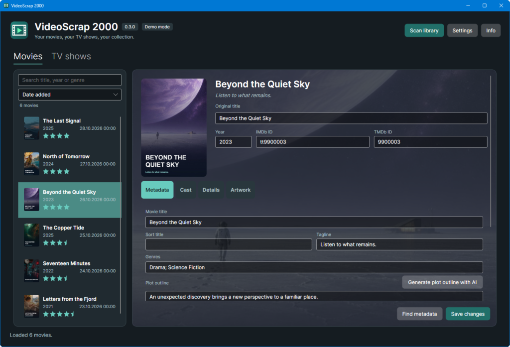
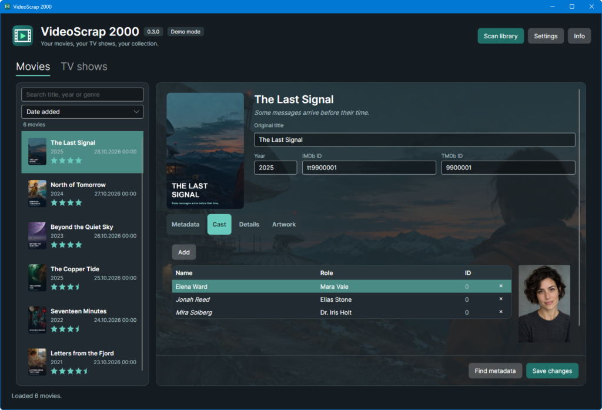
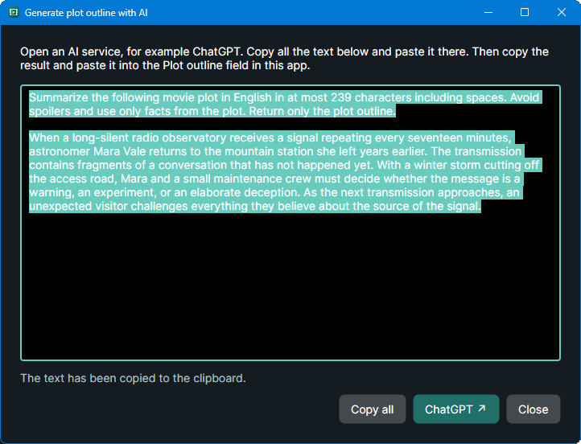
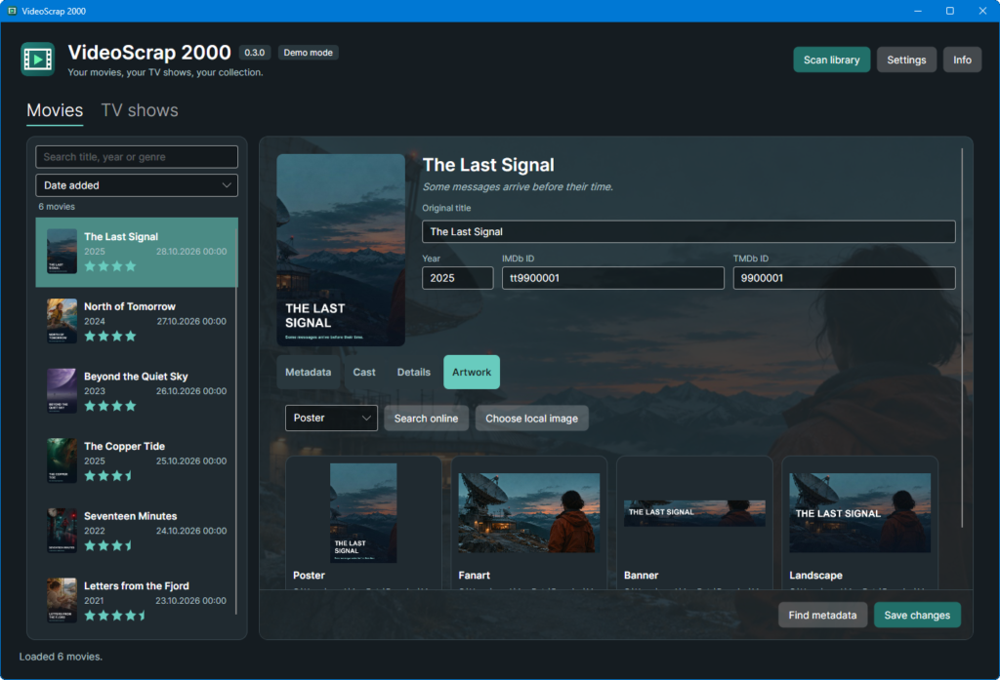
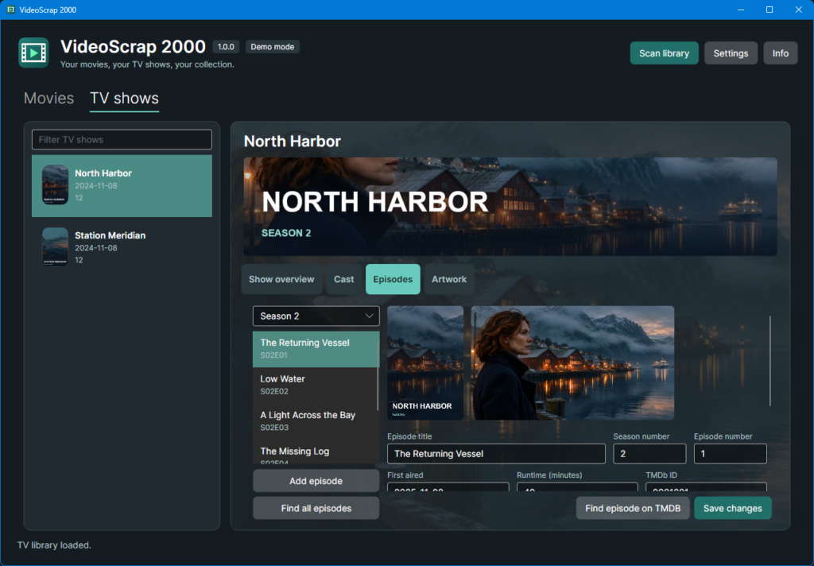

# VideoScrap 2000


VideoScrap 2000 is a desktop library manager for movies and TV shows on Windows, Linux, and macOS. Browse your collection, find metadata and artwork, and save the results as NFO and image files beside your videos. It works with local folders and mounted network shares.

[GitHub Releases](https://github.com/gruetze-software/VideoScrap2000/releases)











## Features

- **Browse your collection.** See poster thumbnails, release years, and ratings on a five-star scale with half stars. Filter by title, year, or genre. Sort by name, release year, or the creation date of the movie's NFO file.
- **Find movies that need attention.** Films without metadata appear in green at the top of the list. If a folder is unreachable, the cached title, year, and rating remain visible. Use the context menu to remove stale entries from the local cache.
- **Match films with TMDB.** Search by title, year, or IMDb ID. For movies without NFOs, the app infers a title and year from the filename when it can. Poster thumbnails in the search dialog help distinguish similarly named films.
- **Edit metadata and cast.** Work with titles, taglines, genres, plot summaries, release dates, ratings, certifications, countries, studios, collections, and IMDb and TMDB IDs. The cast tab shows roles and available portraits. Select multiple cast entries to remove them together.
- **Find or import artwork.** Choose posters, fanart, clear logos, clear art, banners, disc art, key art, and landscape images from the available sources, or select a local file. Search for one type or use **All** to select the first result for each type. On the first TMDB match, or when the film has no artwork, the app automatically searches for missing types.
- **Choose images while previews load.** Pick a result and apply it while other previews are still downloading. Double-click a local artwork tile to open the image in your default viewer.
- **Save changes in the movie folder.** Metadata and selected artwork are staged until you choose **Save changes**. Existing NFOs and replaced artwork are backed up as `.bak` files. NFO fields managed by other tools are preserved when possible.
- **Follow your system language.** The interface is available in English and German and automatically starts in the system language (English on systems using another language). Metadata and artwork preferences also default to the system language. Override the interface, metadata, and artwork languages separately in Settings. Preferred-language artwork appears first; images in other languages remain available.
- **Customize the appearance.** Use light, dark, or system appearance and optionally show dimmed fanart behind the movie and TV-show details.
- **Manage TV shows separately.** The **TV shows** tab groups videos by show and season. Edit show and episode metadata or fetch it from TMDB. Manage the show cast with roles, TMDB IDs, and portraits. The artwork section offers a search dialog with a choice of image types for the show or a selected season, including an **All** option that takes the first available result per type. Browse previews from TMDB and Fanart.tv, with your preferred language listed first. Selected artwork is written when you save. A responsive season banner spans the detail area above the section buttons. The season poster and the selected episode's still sit beside each other above the editable details and scroll with the form, leaving the episode list available for navigation. In **All seasons**, the images follow the selected episode. Use **Find all episodes** to fetch metadata for the local episodes of the selected show. Every **Save changes** button saves the show metadata, pending artwork, the selected episode, and any fetched episode updates together. The optional backdrop uses season fanart when available. Matching a show searches for missing artwork from Fanart.tv and uses available TMDB posters and show backdrops as fallbacks.
- **Draft a short outline with AI.** The **Generate plot outline with AI** button opens a dialog with instructions and an editable prompt for a spoiler-free outline of up to 239 characters. The prompt is copied to the clipboard automatically. Open an AI service, such as ChatGPT using the dialog's button, paste the prompt, and copy the result back into the app's Plot outline field.
- **Read technical video details automatically.** When a movie has no usable stream information in its NFO, MediaInfo reads the video file in the background. Video codec, resolution, aspect ratio, duration, audio tracks, and subtitles appear in Details and are included when you save. Click a displayed movie file path to open it in its default application.
- **Reuse previews while browsing.** Covers, artwork, cast portraits, and search previews share a bounded runtime cache. Decoded previews use up to 96 MiB of cache space, with a separate 32 MiB cache for online image downloads. Replaced artwork is invalidated when saved. External file changes are checked after 30 seconds on the next access, or when you rescan the library.

## Get started

### Try demo mode

Open **Settings → Demo mode → Open demo mode**. The demo starts in English with a dark theme and fictional movies, TV shows, seasons, episodes and cast. Each movie has its own cover motif and color palette. Original AI-generated artwork is bundled as compressed JPEGs; no TMDB or Fanart.tv content is fetched.

- **Movies:** select **The Last Signal** for a populated movie page, artwork and cast.
- **TV shows:** select **North Harbor**, then **Episodes**, to show the season poster, banner and episode still beside the episode editor.
- **AI prompt dialog:** with **The Last Signal** selected, open **Metadata → Generate plot outline with AI**. Its longer English plot and empty plot outline are prepared for demonstrating the editable prompt, 239-character limit, automatic clipboard copy and optional ChatGPT browser button. The app does not call an AI API or generate the summary itself.

The demo has a separate local database and media folder. Saving and theme/language changes affect only the demo session, not your collection or saved settings. Reopening the demo restores its sample metadata. Use **Settings → Back to my collection** to leave. Placeholder videos are not playable. You can also launch the app with `--demo`.

### Use your own library

1. Download and extract the archive for your operating system and architecture from **GitHub Releases** when a release is available. Launch `VideoScrap2000.exe` on Windows or `VideoScrap2000` on Linux or macOS.
2. Open **Settings** and select your movie folder. Use one subfolder per movie. If a folder contains multiple supported video files, the scanner uses the largest one.
3. Choose **Scan library** to read existing NFOs and list the movies. Use **Find metadata** to match a film, then review the metadata and artwork before saving.

The local SQLite cache keeps the movie collection searchable between scans. Movie NFOs and artwork stay in their film folders. See **Kodi support** below for importing new items and refreshing existing library entries.

For TV, choose a **TV folder** in Settings, with one subfolder per show and optional season folders. Open **TV shows** and choose **Scan library**. Episode names such as `Show S01E02.mkv` or `Show 1x02.mkv` supply season and episode numbers when there is no NFO. You can also add a video from within the show folder and enter its numbers manually. Show metadata goes into `tvshow.nfo`. Each episode uses an NFO with the same basename as its video. The editor handles one episode per video file.

## Kodi support

VideoScrap 2000 prepares local metadata and artwork for Kodi. Save your edits in VideoScrap 2000, then let Kodi import the files from the same media folders, including folders on a NAS or mounted network share. VideoScrap 2000 has its own local cache; it does not connect to or modify Kodi's SQLite or shared MySQL/MariaDB database, and does not send remote update commands to Kodi.

### Metadata and files

- **Movies:** Kodi-compatible XML NFOs normally use the video's basename, for example `Arrival.mkv` and `Arrival.nfo`. An existing imported `movie.nfo` is retained when saving. Supported fields include titles, release dates, plot and plot outline, tagline, genres, ratings, certification, countries, studios, collections, cast and roles, and provider IDs.
- **TV shows:** show details are saved in `tvshow.nfo` in the show's root folder. Each episode has an `<episodedetails>` NFO beside its video, for example `Fargo S01E01.mkv` and `Fargo S01E01.nfo`, including its season and episode numbers. The editor currently handles one episode per video file.
- **Artwork:** selected posters, fanart and other artwork are stored locally. TV artwork includes show-level and season-specific images such as `poster.jpg`, `fanart.jpg`, `banner.jpg`, `season01-poster.jpg` and `season01-banner.jpg`, where available. Episode stills use `<video basename>-thumb` image files. The artwork types Kodi displays depend on its skin and artwork settings.
- **Technical movie details:** video codec, resolution, aspect ratio, duration, audio tracks and subtitles are written to the NFO's `<fileinfo><streamdetails>` section when available.
- **Date added:** a new movie NFO receives the first-save date in `<dateadded>`. Subsequent saves preserve a valid existing value; an existing NFO without one uses its creation date. The release year remains a separate field. Kodi's own import settings determine how the date is used in its library.
- **Existing files:** replaced NFOs and artwork receive `.bak` backups. Unmanaged movie NFO elements and unedited TV NFO fields are preserved where possible.

### Import into Kodi

1. Add the media folders as video sources in Kodi and set the correct content type: **Movies** or **TV shows**. If VideoScrap 2000 supplies all metadata, choose **Local information only** as the information provider.
2. For **new movies or episodes**, use **Update library** or **Scan for new content** in Kodi. Kodi reads the local NFOs and artwork during import.
3. For **changes to an existing entry**, open its **Information** page and choose **Refresh**. Keep the local information when Kodi offers to ignore it and search online. A normal library update discovers new items but does not reread changed NFOs for existing entries.

For a shared Kodi database on a NAS, the import or refresh still runs through Kodi. Each client must be able to access the media paths used by that library.

See the official Kodi guides for [NFO files](https://kodi.wiki/view/NFO_files), [TV-show NFOs](https://kodi.wiki/view/NFO_files/TV_shows), and [updating versus refreshing a library](https://kodi.wiki/view/Updating_or_removing_videos).

## Metadata and artwork sources

[](https://www.themoviedb.org/) &nbsp; [](https://fanart.tv/)

[TMDB](https://www.themoviedb.org/) provides movie details, cast information, and artwork. [Fanart.tv](https://fanart.tv/) provides additional artwork types. Packages built with the Fanart.tv project key work without per-client setup. You can optionally set your [personal Fanart.tv key](https://fanart.tv/get-an-api-key/) in `FANART_TV_API_KEY` and restart the app.

Episode updates fetch available stills from TMDB, with [TVmaze](https://www.tvmaze.com/) as a fallback for shows matched by IMDb or TheTVDB ID. TVmaze API data is provided under [CC BY-SA](https://www.tvmaze.com/api#licensing). The selected episode's still appears beside the season poster. Saving writes new stills alongside their videos as `<video basename>-thumb` image files.

### Languages and availability

The interface supports **English and German**. Metadata and artwork languages are independent of the interface language: their automatic setting preserves the client's original language and region, such as `fr-CA` or `pt-PT`, even when the interface falls back to English. Settings show the detected client culture, the current metadata request language, and the preferred artwork language. You can override metadata and artwork languages separately from a list of ISO-639-1 languages, including selected regional variants. Unsupported client language codes fall back to English.

TMDB supports [localized metadata in many languages](https://developer.themoviedb.org/docs/languages), but translations vary by title and field. A missing translation can produce an original-language value or an empty field; names and roles are not consistently localized. VideoScrap 2000 does not automatically translate missing text.

TMDB and Fanart.tv supply images in the languages available for the title. Results are ranked **preferred language → language-neutral → other languages**; other languages remain visible. TMDB currently tags image languages without regional variants, so `fr-CA` prefers `fr` images. Text inside images is not translated. Episode stills and most backdrops are language-neutral. See [TMDB image languages](https://developer.themoviedb.org/docs/image-languages) and the [Fanart.tv API](https://fanart.tv/api-docs/api-v3/).

> This product uses the TMDB API but is not endorsed or certified by TMDB.

## Build and release

Install the .NET 10 SDK to build from source.

```powershell
dotnet run --project MovieScrap2000/MovieScrap2000.csproj
dotnet test VideoScrap2000.Tests/VideoScrap2000.Tests.csproj -m:1
./scripts/Publish.ps1 -Runtime win-x64
```

The desktop app lives in `MovieScrap2000`, the platform-independent core in `VideoScrap2000.Core`, and the test suite in `VideoScrap2000.Tests`. The app continues to use the existing SQLite cache in its `MovieScrap2000` application data folder.

GitHub Actions tests on Windows, Linux, and macOS. The packaging workflow builds separate x64 and ARM64 archives for each platform. Each platform has two downloads. **Self-contained** packages include .NET 10 and run after extraction. Smaller **framework-dependent** packages require the matching .NET 10 Runtime to be installed. Use `-FrameworkDependent` to build this smaller variant locally. Packages are checked for debug symbols, test components, editor files, and libraries for other operating systems. Archives use maximum compression and include separate SHA-256 checksums and size manifests. Universal macOS libraries are reduced to the selected CPU architecture when packaging on macOS. Linux uses X11 or XWayland. macOS packages contain an executable directory.

To prepare a release, push a version tag matching the project version, for example `v0.3.0`. Alternatively, run **Build and platform packages** from **Actions** and enable **Create or update the unpublished release draft after packaging**. After tests and package checks succeed, the workflow creates or updates the draft with all twelve archives, checksums, manifests and measured download/extracted sizes. Already published releases cannot be overwritten by this workflow. Review the draft before publishing. Leave the option disabled to build archives without changing a release.

For builds with Fanart.tv enabled, set the GitHub Actions repository secret `FANART_TV_PROJECT_API_KEY` to the app's project key. The packaging workflow uses it on `main` and version tags. Local release builds accept the same environment variable. For local development and debugging, set FANART_TV_PROJECT_API_KEY in the environment inherited by the app and restart your IDE. The GitHub secret is available inside GitHub Actions only. The project key is embedded in the resulting binaries and can be extracted, so use the app's project key only.

[Icon PNG](docs/VideoScrap-2000-icon.png) · [Layered Paint.NET source](docs/VideoScrap-2000-icon.pdn) · [Paint.NET drawing guide (German)](docs/Paint.NET-Anleitung-App-Symbol.md) · [Third-party notices](THIRD-PARTY-NOTICES.md) · [Grütze-Software](https://github.com/gruetze-software) · [Ko-fi](https://ko-fi.com/gruetzesoftware)
